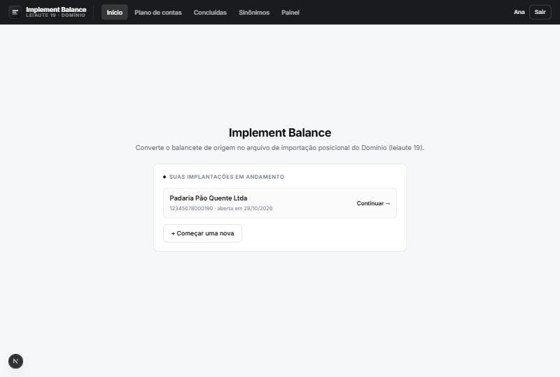
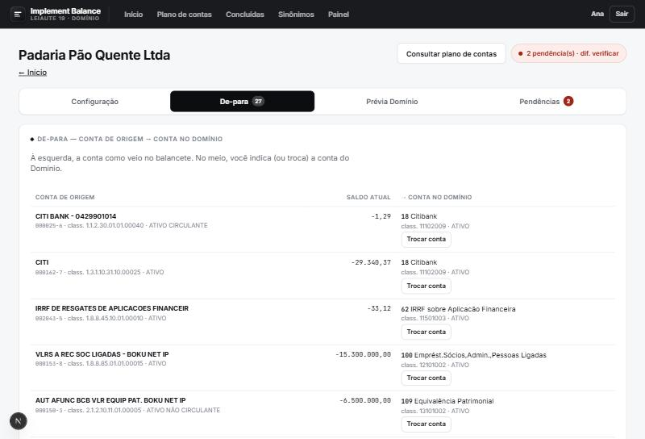
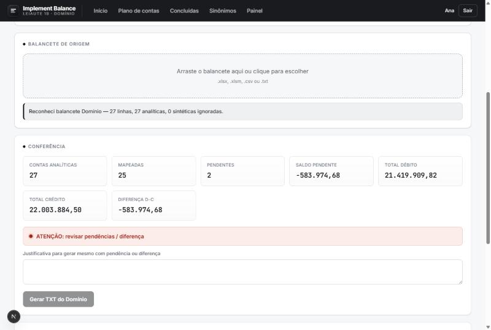
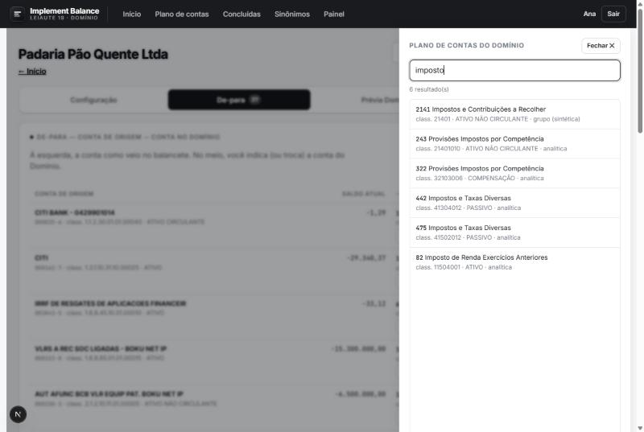

# Implement Balance

> Converte o **balancete de verificação** de um cliente no **arquivo de importação posicional do
> sistema Domínio** (leiaute 19) — automatizando um trabalho que antes era feito à mão em planilhas.

**▶ Demo ao vivo:** https://implement-balance.vercel.app — crie uma conta para entrar (o primeiro
cadastro recebe perfil de administrador).

Aplicação web completa (Next.js + Postgres) que recebe o balancete exportado de qualquer sistema
contábil, faz o **de-para** das contas para o plano de contas do Domínio e gera o **TXT de importação
byte a byte idêntico** ao que a planilha de referência produzia — com login, trilha de auditoria e
acompanhamento por usuário.

<p>
  
  
  
  
  
  
</p>

---

## O problema

Em um escritório de contabilidade, implantar os saldos de uma empresa nova no sistema **Domínio**
significa pegar o balancete de origem (de outro sistema), descobrir, conta por conta, qual conta do
plano do Domínio corresponde a cada uma, e montar um arquivo texto de posições fixas no formato exato
que o Domínio importa. Feito à mão em planilha, é lento, repetitivo e fácil de errar.

## A solução

O **Implement Balance** faz isso em uma tela só:

1. A pessoa cria a conta e entra (e-mail + senha).
2. Começa uma implantação, informa os dados da empresa e **arrasta o balancete** (`.xlsx`, `.xlsm`,
   `.csv` ou `.txt`). O sistema reconhece o layout; se não reconhecer, a pessoa aponta as colunas.
3. No **de-para**, cada conta de origem aparece ao lado da sua conta no Domínio; o que o motor não
   resolveu sozinho fica como **pendência** para a pessoa indicar.
4. A **prévia** mostra como o balancete fica no plano do Domínio, e o botão gera o **TXT** — que sai
   idêntico, linha por linha, ao da planilha de referência.

O motor foi validado contra a planilha original: para o balancete de referência, produz o **mesmo TXT
byte a byte** (24 lançamentos, R$ 22.003.884,50 em débito e em crédito, diferença zero — verificado
por hash em teste automatizado).

## Capturas de tela

| Início (suas implantações) | De-para com a coluna de indicação |
| --- | --- |
|  |  |

| Conferência (painel) | Consulta ao plano sem sair do de-para |
| --- | --- |
|  |  |

## Funcionalidades

- **Cadastro e login próprios** (e-mail + senha, hash scrypt) com recuperação de senha por e-mail
  (código com validade); sessão assinada (Auth.js) e middleware que exige login.
- **Várias implantações em andamento por pessoa** (uma por empresa), com nome da empresa, para pausar
  uma e retomar depois.
- **Leitura de balancete** em `.xlsx`/`.xlsm`/`.csv`/`.txt`, com reconhecimento de layout por
  cabeçalho, detecção de contas sintéticas pelo **negrito** da planilha e **mapeamento manual de
  colunas** quando o layout é novo.
- **De-para em abas**: conciliação com coluna central de indicação, **prévia do balancete no Domínio**
  e lista de **pendências** — tudo trocando com um clique, sem rolar a página.
- **Consulta ao plano de contas** em painel lateral, sem sair da conciliação.
- **Base de sinônimos** (aprende "este nome → esta conta") com fila de revisão e histórico imutável.
- **Geração do TXT leiaute 19** (registros 01/02/03/99, valores ×100 em 15 dígitos, CRLF) com trava:
  só libera com CNPJ, código da empresa, zero pendências e diferença zero — ou justificativa.
- **Trilha de auditoria** e **tempo por implantação**, base para o painel de acompanhamento por
  usuário (quem fez o quê e quanto demorou).

## Stack

- **TypeScript** (strict), **Node 22+**, módulos ESM/NodeNext.
- **Next.js 15** (App Router, Server Actions) + **React 19**.
- **Drizzle ORM** + **PostgreSQL 16** em produção; **PGlite** (Postgres embutido) em desenvolvimento e
  nos testes — o mesmo schema e as mesmas migrações nos dois.
- **Auth.js (NextAuth v5)** com provedor de credenciais próprio.
- **ExcelJS** para ler planilhas (inclusive a formatação em negrito).
- **Vitest** + **Testing Library** para a suíte de testes.

## Arquitetura

O coração é um **motor puro** (`src/motor/`) e os **leitores** (`src/leitores/`): funções sem banco,
rede, Next ou acesso a arquivo — recebem balancete, plano e regras e devolvem linhas resolvidas,
lançamentos, TXT e o painel. Essa pureza é garantida por um teste (`tests/motor/pureza.test.ts`) e
torna a lógica de negócio fácil de testar e de confiar.

```
src/
  motor/        regras de negócio puras (normalização, natureza, resolução, agregação, leiaute 19)
  leitores/     leitura e reconhecimento de layout do balancete (puro)
  dados/        camada de banco (Drizzle): implantações, usuários, plano, sinônimos, auditoria
  acesso/       autenticação (Auth.js), senha (scrypt), e-mail de recuperação, papéis
  app/          UI (Next.js App Router): telas, componentes e Server Actions
drizzle/        migrações versionadas
fixtures/       plano de contas, regras e balancete de referência (dados, não código)
tests/          ~2.4k testes (motor, leitores, dados, acesso, implantação, UI)
```

As **regras de negócio são dados versionados** (plano de contas, normalização, natureza, sinônimos em
`fixtures/`), não código — acrescentar um layout ou uma regra é cadastrar dados, não programar.

## Qualidade

- **2437 testes** automatizados e **typecheck estrito** sem erros.
- Equivalência do TXT provada por **hash** contra a planilha de referência.
- Migrações de banco versionadas; schema idêntico entre desenvolvimento (PGlite) e produção (Postgres).

## Como rodar

Pré-requisito: [Node.js](https://nodejs.org) 22+.

```bash
npm install
npm run dev
```

Abra **http://localhost:3000**, crie uma conta e comece. Em desenvolvimento o banco sobe sozinho
(PGlite, embutido) e já vem com o plano de contas e as regras carregados — não precisa instalar
Postgres para testar.

Para produção, use PostgreSQL definindo `DATABASE_URL` (veja `.env.example`) e rode o build:

```bash
npm run build
npm start
```

Outros comandos:

```bash
npm test         # roda a suíte completa
npm run typecheck
```

## Sobre o desenvolvimento

Projeto desenvolvido em programação assistida por IA (pair programming com um agente), com disciplina
de engenharia: desenvolvimento guiado por testes, núcleo de domínio puro e isolado, tipagem estrita,
migrações versionadas e verificação de equivalência do resultado contra a referência original.

## Licença

[MIT](LICENSE).
